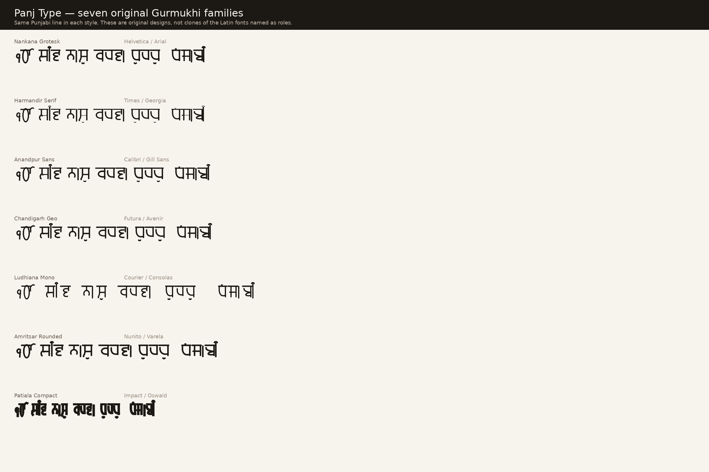

# Panj Type

Free and open-source **Gurmukhi (Punjabi)** fonts.

Seven original families that fill the same *roles* as well-known Latin fonts. They are new designs, not clones — Helvetica, Arial, Times New Roman and the rest are copyrighted, so each face has a Punjabi name and its own outlines.

**License:** [SIL Open Font License 1.1](OFL.txt) — free to use, study, embed, modify, and redistribute.

**1.1** redraws the letters from traditional Gurmukhi painti skeletons (joining headlines, distinct aira, nana, lalla, sassa, kakka, ura) after the first cut read too much like Devanagari.



## Families

| Family | Weights | Latin role | Category |
|---|---|---|---|
| **Nankana Grotesk** | Regular, Bold | Helvetica / Arial | Neo-grotesque sans |
| **Harmandir Serif** | Regular, Bold | Times New Roman / Georgia | Transitional serif |
| **Anandpur Sans** | Regular, Bold | Calibri / Gill Sans | Humanist sans |
| **Chandigarh Geo** | Regular, Bold | Futura / Avenir | Geometric sans |
| **Ludhiana Mono** | Regular, Bold | Courier New / Consolas | Monospace |
| **Amritsar Rounded** | Regular, Bold | Nunito / Varela Round | Rounded sans |
| **Patiala Compact** | Regular | Impact / Oswald | Condensed display |

Reserved font names are the seven family names above (OFL reserved names).

Installable files are in [`fonts/ttf/`](fonts/ttf/).

## Coverage

Every assigned code point in the Unicode Gurmukhi block (U+0A00–U+0A7F):

- Independent vowels ਅ ਆ ਇ ਈ ਉ ਊ ਏ ਐ ਓ ਔ and bearers ੲ ੳ
- Full consonant set plus nukta letters ਖ਼ ਗ਼ ਜ਼ ਫ਼ ਲ਼ ਸ਼ and ੜ
- Matras, bindi, tippi, addak, visarga, virama, yakash, udaat
- Gurmukhi digits ੦–੯ and ੴ Ek Onkar
- Danda / double danda, ZWJ / ZWNJ
- Companion Latin (ASCII) so mixed Punjabi–English text stays on one family

OpenType `mark` and `mkmk` position combining signs. HarfBuzz’s Gurmukhi shaper reorders sihari (ਿ) as a pre-base matra.

## Install

**macOS:** open each `.ttf` in Font Book and install.  
**Linux:** copy `fonts/ttf/*.ttf` to `~/.local/share/fonts/` and run `fc-cache -f`.  
**Windows:** right-click the `.ttf` files → Install.

Then pick the family name (for example **Nankana Grotesk**) in any app that can set a Gurmukhi run of text.

## Build from source

```bash
python3 -m pip install -r requirements.txt
python3 sources/build.py
python3 sources/specimen.py
```

## Honest limits

These are first-generation parametric fonts. Version 1.1 draws each letter from the traditional Gurmukhi painti so a line of Punjabi should read as Gurmukhi, not as Devanagari. They are still not a substitute for a foundry family such as Noto Sans Gurmukhi after years of hinting, kerning, and conjunct work. Proof the letters you actually ship before replacing a production font.

Do not copy outlines from proprietary Latin fonts into this project.

## License

[SIL Open Font License 1.1](OFL.txt). See [FONTLOG.txt](FONTLOG.txt) and [CONTRIBUTING.md](CONTRIBUTING.md).
